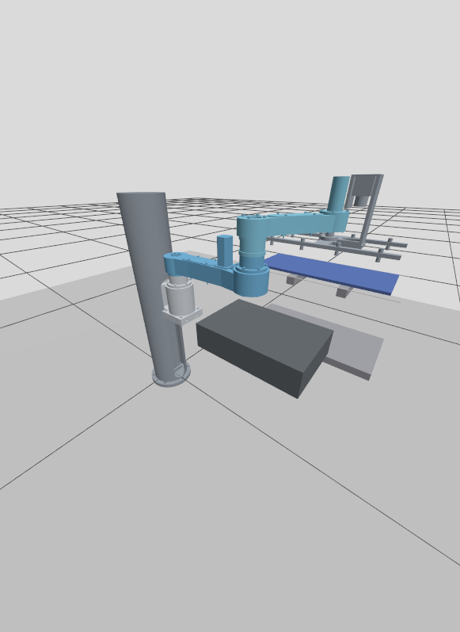

# IC Tray 搬运机器人仿真

固定工位的 ROS 2 / Gazebo 演示：四轴 PRRR 机械臂从静态取料台取起预置托盘，转运到货架上层单槽，释放并退臂。工程使用 ROS 2 Jazzy、Gazebo Harmonic、`ros2_control` 和解析逆运动学；不依赖 MoveIt。



## 范围和模型

- `prrr_arm_description/` 是 SolidWorks 总装导出的 URDF 与五组合并网格。升降轴行程 0–0.3 m，三条旋转轴为 continuous；平面两段臂长 0.25、0.20 m。模型的质量、惯量和占位零件存在限制，见[模型说明](prrr_arm_description/README.zh-CN.md)。
- `ic_tray_sim/` 在启动时生成含控制插件和教学驱动参数的模型副本，不改源 URDF。驱动力和速度不是设备额定值，不能用于实机。
- 工位和托盘由基本几何体构建：托盘 0.3226 × 0.136 × 0.00635 m、0.25 kg；取料台顶面高 0.4 m；货架上层高 0.505 m。参数可在 `ic_tray_sim/config/task.yaml` 修改。
- 吸附由 Gazebo DetachableJoint 固定连接近似，不模拟真空压力或密封，也不检查抓取距离。当前只支持预置位置的一次取放；动态传送带、视觉、导航、AMR、其他槽位和实机控制尚未实现。

另有独立的[车载分离式取放工位预览](artifacts/asset_sourcing/layout/slam/README.zh-CN.md)，包含 Gazebo 场景、站间参考路线、停靠净距和启动命令。预览使用静态 AMR 和机械臂模型。[素材来源与许可](artifacts/asset_sourcing/README.zh-CN.md)

## 安装与运行

需要 Linux 图形环境、Miniforge/Conda 和下载依赖的网络。以下从仓库根目录运行；默认 Miniforge 在 `~/miniforge3`。`environment.yml` 使用 RoboStack Jazzy 和 conda-forge，依赖未锁定，后续解析的包版本可能与验收环境不同。

```bash
git clone https://github.com/emmm-50/ic-tray-gazebo-sim.git
cd ic-tray-gazebo-sim
CONDA_ROOT="$HOME/miniforge3"
CONDA_PKGS_DIRS="$PWD/.conda/pkgs" CONDA_CHANNEL_PRIORITY=strict \
  "$CONDA_ROOT/bin/conda" env create --prefix "$CONDA_ROOT/envs/ic_tray_jazzy" --file environment.yml
bash tools/run_isolated.sh colcon --log-base log/conda build \
  --base-paths prrr_arm_description ic_tray_sim --build-base build/conda --install-base install/conda
bash tools/run_isolated.sh ros2 launch ic_tray_sim sim.launch.py
```

等待控制器和托盘生成完成，在另一个终端进入仓库根目录，执行一次：

```bash
bash tools/run_isolated.sh ros2 run ic_tray_sim pick_place
```

无界面启动可追加 `gui:=false`。修改源码或默认配置后重新构建；使用普通构建，不使用 `--symlink-install`。用 Ctrl+C 停止启动终端。**再次完整演示前应停止旧世界并重启**，以恢复托盘和吸附初态，不要在同一世界中直接重跑已完成的取放。

Miniforge 或环境安装在其他位置时，可分别设置 `IC_TRAY_CONDA_ROOT` 和 `IC_TRAY_ENV_PREFIX`；例如：

```bash
export IC_TRAY_CONDA_ROOT="$HOME/other-miniforge"
export IC_TRAY_ENV_PREFIX="$HOME/my-envs/ic_tray_jazzy"
```

创建环境时也使用相应的 Conda 路径和 prefix。运行入口隔离系统 ROS 路径，使用 ROS domain 73 和独立 Gazebo partition，日志写入项目的 `log/conda/`。使用说明、参数示例和代码入口见[实现与使用](docs/implementation.zh-CN.md)。

## A 位固定停靠取盘

车体固定在 A 位，中心为 `(−2.30, −1.20)`，朝向 −X。机械臂安装点为 `(−2.48, −1.20, 0.25)`，传送台面高 0.65 m，托盘中心平面坐标为 `(−2.91, −1.20)`。场景用简化的静态碰撞体表示车体与传送台。吸取点向车体一侧偏离托盘中心 90 mm，以避开上臂与传送台的干涉。托盘吸附后先垂直抬升，再随机械臂收回，结束时保持吸附。

构建后，在第一个终端启动场景。

```bash
bash tools/run_isolated.sh env ROS_DOMAIN_ID=178 GZ_PARTITION=ic_tray_a_pickup GZ_IP=127.0.0.1 \
  ros2 launch ic_tray_sim sim.launch.py gui:=false task_config:="$PWD/ic_tray_sim/config/a_pickup.yaml"
```

等控制器激活、托盘生成后，在第二个终端执行取盘。

```bash
bash tools/run_isolated.sh env ROS_DOMAIN_ID=178 GZ_PARTITION=ic_tray_a_pickup GZ_IP=127.0.0.1 \
  ros2 run ic_tray_sim pick_place --ros-args -p task_config:="$PWD/ic_tray_sim/config/a_pickup.yaml"
```

用 `gui:=true` 显示场景。

## 验证与限制

已在隔离 Conda 环境中完成 GUI 取盘、搬运、释放和退臂，并成功重播。该验证覆盖预置托盘到上层单槽的一次取放，不代表实机精度或长期可靠性。一次性检查代码和详细验收记录不纳入仓库。

原 CAD 有内部重叠，仿真未启用机械臂内部自碰撞；轨迹结果、仿真吸附状态和最终托盘位置各自说明不同事实。不能据此推断真实吸力、密封、结构强度或运行安全。

## 来源、许可与后续方向

机械臂由 SolidWorks 总装导出；`prrr_arm_description/package.xml` 标记为 **Proprietary**，发布或再利用前请核实权利与授权。本仓库未指定统一的开源许可证，不能据此假定其他内容已获开源授权。

工位与托盘使用本项目基本体。传送台几何参考 [Gazebo 官方示例](https://github.com/gazebosim/gz-sim/blob/gz-sim8/examples/worlds/conveyor.sdf)（[Apache 2.0](https://github.com/gazebosim/gz-sim/blob/gz-sim8/LICENSE)）；[OSRF bookshelf](https://github.com/osrf/gazebo_models/blob/master/bookshelf/model.sdf)（[CC BY 3.0](https://github.com/osrf/gazebo_models/blob/master/LICENSE)）仅作尺寸和素材调研，未直接使用。接口参考 [ROS/Gazebo 版本对应](https://gazebosim.org/docs/harmonic/ros_installation/)、[gz_ros2_control](https://control.ros.org/jazzy/doc/gz_ros2_control/doc/index.html) 和 [DetachableJoint](https://gazebosim.org/api/sim/8/detachablejoints.html)。

后续可先完善多槽位、下层插入及碰撞验证，再结合实际安装高度集成移动底盘、导航和视觉。实机前需要实测模型、驱动限值、抓取及安全条件。
