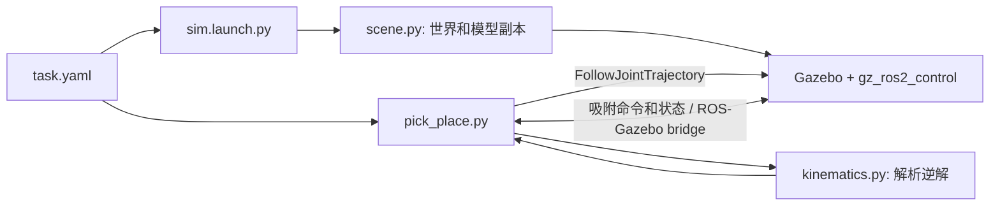

# 实现与使用

本项目一次演示将预置托盘从取料台搬到货架上层。先按[首页](../README.md)创建环境、构建并启动仿真，再在另一个终端执行 `pick_place`。两个终端都从仓库根目录执行，运行入口会加载隔离环境和已构建的包。



## 入口和启动顺序

- `ic_tray_sim/launch/sim.launch.py` 的 `start()` 读取配置，调用 `scene.py` 的 `world()`、`robot_xml()` 和 `tray_sdf()`。模型副本加入控制接口、教学驱动参数和吸附插件，源 URDF 不被改写。
- launch 启动 Gazebo、`robot_state_publisher` 和桥接，再生成机械臂；生成成功后启动 `joint_state_broadcaster` 和 `arm_controller`，控制器启动成功后生成托盘。Gazebo 插件初始建立连接，机械臂初始处于取料点上方；动作开始时先解除初始连接。
- `ic_tray_sim/ic_tray_sim/pick_place.py` 的 `Transfer.run()` 计算目标并执行一次任务；`move()` 等待轨迹 action 结果，`suction()` 等待插件状态。控制器配置在 `ic_tray_sim/config/controllers.yaml`。

## 运动和吸附

`kinematics.py` 的 `solve(x, y, z, yaw, elbow_sign)` 默认使用正肘解析解，`elbow_sign=-1` 选择负肘。`forward(q)` 用于正向计算。坐标以米、弧度表示，X 方向肩轴偏移 0.12 m，两段长度 0.25 和 0.20 m，`tool0` 零升降高度 0.2855 m。升降超出 0–0.3 m 或平面不可达会报错。碰撞需要沿轨迹另行检查。默认 yaw 为 0，关节顺序为升降、肩、肘、腕。

逆解的核心就是两连杆三角形：先用 `x′ = x − 0.12` 把目标换到肩轴坐标，令 `a = 0.25`、`b = 0.20`，再计算：

```text
lift     = z − 0.2855
elbow    = acos((x′² + y² − a² − b²) / (2ab))
shoulder = atan2(y, x′) − atan2(b·sin(elbow), a + b·cos(elbow))
wrist    = yaw − shoulder − elbow
```

这把目标工具位置和朝向变成四个关节目标，当前选取 `acos` 的正肘支路。它没有搜索其他支路，也没有自动生成避障路径；工位布局和整段运动间距需要另行验证。

一次任务依次解除初始连接，下降取料、连接、带盘升起、转运至上层、下降放盘、解除连接并退至货架上方。五段轨迹各设 5 秒目标时间，升降到位容差 2 mm、转轴 0.01 rad，允许额外 3 秒到位；脚本等待 action 成功后才继续。

`/suction/attach` 和 `/suction/detach` 是桥接到 Gazebo 的命令，`/suction/state` 返回 `attached` 或 `detached`。状态桥和订阅者配置 transient-local、depth 1：收到目标状态时直接继续；状态未知或不同时发送命令并等待反馈。`attached` 只表示固定关节建立，即使距离较远插件也允许连接；配置的 1 mm 间隙不是实测密封接触。

## 修改配置

`ic_tray_sim/config/task.yaml` 的长度为米、质量为千克：

- `pickup.x/y/surface` 是取料点和台面高度；`conveyor.size` 是台体尺寸。
- `tray.size/mass` 是托盘长宽厚及质量；`shelf.x/y` 是目标中心，`levels` 的最后一项是上层放置高度；其余字段定义单槽支撑几何。
- `suction_gap` 是工具相对于盘顶的名义间隙；`travel_lift` 是升降关节的搬运高度，不是世界 Z 坐标。对应工具高度为 0.2855 m 加上该值。

例如复制一份配置到仓库根目录 `my-task.yaml`，修改数值后，将同一绝对路径传给两个进程：

```bash
TASK_CONFIG="$PWD/my-task.yaml"
bash tools/run_isolated.sh ros2 launch ic_tray_sim sim.launch.py task_config:="$TASK_CONFIG"
# 在另一个仓库根目录终端：
TASK_CONFIG="$PWD/my-task.yaml"
bash tools/run_isolated.sh ros2 run ic_tray_sim pick_place --ros-args -p task_config:="$TASK_CONFIG"
```

改变布局后需检查升降范围、平面可达性、整臂与托盘/工位间距和托盘承托；当前脚本并不自动规划避障。更换配置时先停止旧世界再启动。

## 定位问题

先查看 launch 与动作终端输出。`Trajectory controller unavailable` 表示 action 服务未在等待时间内出现；检查控制器是否启动。`Target outside ...` 指目标超出解析运动学范围；检查配置和单位。`Trajectory rejected/failed` 或超时应检查控制器、关节反馈和实际场景干涉。`No Gazebo suction state confirmation` 表示未收到目标状态，检查桥接、插件及托盘生成；收到 `attached` 也不能证明真空密封。日志位于 `log/conda/`。动作显示完成后，仍需观察托盘最终位置与支撑情况。
